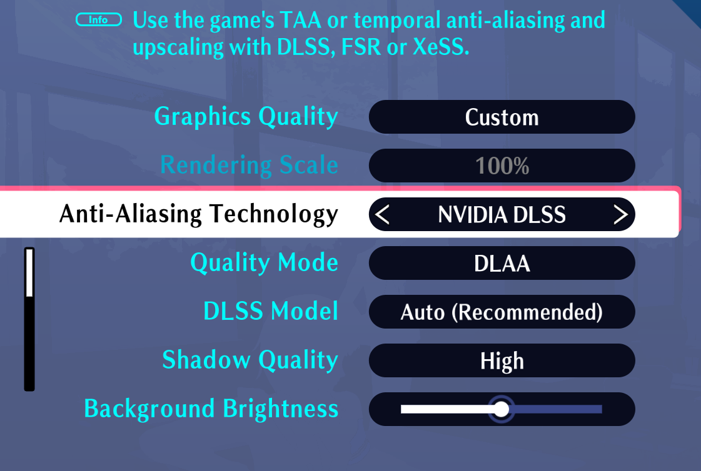

# RE:FRAME — Persona 3 Reload

[English](../../README.md) · [Français](README.fr-FR.md) · [Italiano](README.it-IT.md) · [Deutsch](README.de-DE.md) · [Español (España)](README.es-ES.md) · [日本語](README.ja-JP.md) · [한국어](README.ko-KR.md) · **[Polski](README.pl-PL.md)** · [Português (Brasil)](README.pt-BR.md) · [Русский](README.ru-RU.md) · [简体中文](README.zh-CN.md) · [繁體中文](README.zh-TW.md) · [Türkçe](README.tr-TR.md) · [Українська](README.uk-UA.md)

<!-- source-readme: 8deef3923bb5be1cd0937c169e899628281472fb -->

   [](../../LICENSE)

Wygładź poszarpane krawędzie i ogranicz migotanie w **Persona 3 Reload** bez ustawiania skali renderowania na 200%. DLAA oraz natywne AA w FSR lub XeSS wygładzają krawędzie w rozdzielczości ekranu. Jeśli zależy Ci na wydajności, wybierz tryb skalowania obrazu.

**[Opublikowane wersje RE:FRAME](https://github.com/Aporial/reframe-p3r/releases/latest)**



*Opcje RE:FRAME są dostępne w menu grafiki samej gry.*

## Instalacja

1. Zamknij grę i pobierz **REFRAME-P3R-v1.1.4.zip** z [GitHub Releases](https://github.com/Aporial/reframe-p3r/releases/latest).
2. Na Steam kliknij prawym przyciskiem myszy **Persona 3 Reload** i wybierz **Właściwości → Zainstalowane pliki → Przeglądaj**.
3. Rozpakuj ZIP do folderu, w którym jest już katalog `P3R`. Archiwum umieści `d3d12.dll` obok `P3R.exe` w `P3R\Binaries\Win64`.
4. Uruchom grę normalnie przez Steam.
5. Otwórz ustawienia grafiki i wybierz **Technologia wygładzania** tuż pod skalą renderowania (**Rendering Scale**). Jeśli jest dostępny, wybierz tryb jakości, a następnie zatwierdź zmiany.

**W `P3R\Binaries\Win64` jest już plik `d3d12.dll`?** Może należeć do innego moda. Sprawdź, który mod go używa, i odinstaluj go zgodnie z jego instrukcją przed rozpakowaniem ZIP-a.

ZIP zawiera mod i potrzebne biblioteki graficzne. Wszystko ustawisz w grze, bez ReShade, menedżera modów, nakładki, osobnego launchera ani ręcznej zmiany konfiguracji.

### Aktualizacja i odinstalowanie

- **Aktualizacja** · Zamknij grę, uruchom deinstalator poprzedniej wersji i rozpakuj nowy ZIP. Aby zachować ustawienia z wersji rozwojowej, zostaw `P3RGraphicsEnhanced\Settings.ini`, aż RE:FRAME zapisze je w `ReFrame\Settings.ini`.
- **Odinstalowanie** · Zamknij grę i uruchom `Remove-ReFrame.ps1` z `P3R\Binaries\Win64\ReFrame`. Skrypt sprawdza sumy kontrolne plików i zachowuje zapisane ustawienia oraz dzienniki. Dodaj `-WhatIf`, aby wyświetlić podgląd. [Instrukcja instalacji i odinstalowania](INSTALLATION.pl-PL.md)

[Instalacja](#instalacja) · [Dlaczego nie używać skali renderowania 200%?](#dlaczego-nie-u%C5%BCywa%C4%87-skali-renderowania-200) · [Który tryb wybrać?](#kt%C3%B3ry-tryb-wybra%C4%87) · [Funkcje](#funkcje) · [Obsługiwane karty graficzne](#obs%C5%82ugiwane-karty-graficzne) · [Ustawienia i tryby zaawansowane](#ustawienia-i-tryby-zaawansowane) · [Zgodność i ograniczenia](#zgodno%C5%9B%C4%87-i-ograniczenia) · [Rozwiązywanie problemów](#rozwi%C4%85zywanie-problem%C3%B3w) · [Kompilowanie ze źródeł](#kompilowanie-ze-%C5%BAr%C3%B3de%C5%82) · [Licencja](#licencja)

## Dlaczego nie używać skali renderowania 200%?

Przy 1920×1080 widać czasem poszarpane krawędzie i migotanie drobnych szczegółów. Wyższa skala renderowania może je złagodzić, ale bardziej obciąża kartę graficzną.

| Skala renderowania | Obraz obliczany na ekranie 1080p |
| --- | --- |
| **100%** | 1920×1080, około 2,1 mln pikseli na klatkę |
| **200%** | 3840×2160, około 8,3 mln pikseli na klatkę |

**Przy 200% szerokość i wysokość się podwajają, więc gra oblicza cztery razy więcej pikseli.** Natywne AA wygładza krawędzie przy 100%, łącząc informacje z kolejnych klatek. Ono również obciąża GPU, a wynik porównania z 200% zależy od sceny.

Skalowanie obrazu zaczyna od mniejszej liczby pikseli, niż pokazuje ekran. Może zwiększyć liczbę FPS, gdy ograniczeniem jest GPU.

## Który tryb wybrać?

- **Oryginalne TAA** · Wygładzanie krawędzi wbudowane w grę, z ręcznym ustawianiem skali renderowania.
- **NVIDIA DLAA** · Gładsze krawędzie przy 100%. Jeśli masz zgodną kartę RTX i zależy Ci na jakości obrazu, zacznij od tego trybu.
- **AMD FSR Natywne AA** · Wygładzanie AMD przy 100% na zgodnym sprzęcie.
- **Intel XeSS Natywne AA** · Wygładzanie Intel przy 100% na zgodnym sprzęcie.
- **DLSS / FSR / XeSS Jakość** · Dobry pierwszy wybór do skalowania. Gra renderuje w niższej rozdzielczości, a następnie odtwarza obraz w wybranej rozdzielczości wyjściowej.
- **Zrównoważony / Wydajność** · Renderują w niższej rozdzielczości niż **Jakość**, jeszcze bardziej odciążając kartę. Drobne szczegóły mogą być mniej ostre.

| Cel | Zalecana opcja |
| --- | --- |
| Priorytet jakości obrazu na RTX | NVIDIA DLAA |
| Wygładzanie w rozdzielczości ekranu bez RTX  |  Natywne AA w FSR lub XeSS, jeśli jest dostępne |
| Więcej FPS  |  DLSS, FSR lub XeSS w trybie **Jakość** |
| Maksymalna wydajność  |  **Wydajność** lub **Zrównoważony** jako kompromis |

Dostępność i wyniki zależą od GPU, sterownika i sceny. Menu pokazuje opcje zgłaszane przez Twój system jako dostępne.

## Funkcje

- Wygładzanie w natywnej rozdzielczości i skalowanie obrazu za pomocą NVIDIA DLAA/DLSS, AMD FSR i Intel XeSS.
- Ustawienia w menu gry i automatyczna skala renderowania w trybach SDK.
- Automatyczne wykrywanie 13 języków interfejsu.
- Instalacja z ZIP-a i skrypt do odinstalowania. Uruchamianie przez Steam z menu i sterowaniem gry.

## Wymagania

RE:FRAME wymaga legalnie kupionej na Steam kopii Persona 3 Reload, Windows 10 lub 11 x64, DirectX 12 i odpowiedniego sterownika graficznego. Wersja 1.1.4 jest przeznaczona dla **kompilacji Steam 22672075** (ID aplikacji **2161700**).

### Obsługiwane karty graficzne

| Technologia | Obsługiwane karty |
| --- | --- |
| **NVIDIA DLAA / DLSS** | Zgodne karty GeForce RTX z obsługiwanym sterownikiem. [NVIDIA DLSS](https://www.nvidia.com/en-us/geforce/technologies/dlss/) |
| **AMD FSR** | SDK może udostępnić FSR 4.1.2 na zgodnych kartach Radeon RX z serii 6000, 7000 i 9000. FSR 3.1.6 jest dostępne na innych GPU spełniających wymagania SDK. [SDK AMD FSR](https://gpuopen.com/amd-fsr-sdk/) |
| **Intel XeSS** | Zgodne układy Intel Iris Xe i Arc oraz obsługiwane GPU innych producentów z Shader Model 6.4 i przyspieszeniem DP4a. [Wymagania Intel XeSS](https://github.com/intel/xess/blob/v3.0.2/doc/xess_sr_developer_guide_english.md#requirements) |

XeSS wymaga Microsoft Visual C++ Redistributable x64 **14.40.33810 lub nowszego**. Intel podaje dla tego SDK co najmniej kompilację 19043 Windows 10 i 22000 Windows 11. [Instalacja bibliotek XeSS](https://github.com/intel/xess/blob/v3.0.2/doc/xess_sr_developer_guide_english.md#deployment) · [Microsoft Visual C++ Redistributable](https://learn.microsoft.com/en-us/cpp/windows/latest-supported-vc-redist)

## Ustawienia i tryby zaawansowane

Wybierz **Technologia wygładzania**, a potem dostępny **Tryb jakości**. Opcja **Model DLSS** pojawia się dla NVIDIA DLSS. Przy **Oryginalne TAA** zmienisz skalę ręcznie. Gdy steruje nią SDK, ustawienie pokazuje jego wartość docelową. Zatwierdź lub anuluj zmiany w zwykłym oknie gry. Powrót do **Oryginalne TAA** i ustawienie nowej ręcznej skali możesz potwierdzić razem.

**Ostrość** reguluje szczegółowość po rekonstrukcji przez DLAA, DLSS, FSR lub XeSS, przed narysowaniem HUD-u. Zakres wynosi od 0% (domyślnie, wyłączona) do 100% co 5%. Zastosuj zmianę, aby zobaczyć efekt bez ponownego uruchamiania gry. Wartość jest wspólna dla technologii i trybów jakości. Oryginalne TAA ukrywa tę opcję.

### Dostępne tryby

| Tryb | NVIDIA DLSS | AMD FSR | Intel XeSS |
| --- | --- | --- | --- |
| Natywne AA (100%) | DLAA | Natywne AA | Natywne AA |
| Jakość ultra+ | — | — | Jeśli dostępny |
| Jakość ultra | — | — | Jeśli dostępny |
| Jakość | ✓ | ✓ | ✓ |
| Zrównoważony | ✓ | ✓ | ✓ |
| Wydajność | ✓ | ✓ | ✓ |

Trzy SDK dają łącznie do 14 trybów. Dostępne jest także **Oryginalne TAA**.

### Modele DLSS

| Model | Używany model |
| --- | --- |
| **Auto (zalecane)** | K dla DLAA oraz trybów **Jakość** i **Zrównoważony**. M dla trybu **Wydajność**. |
| **DLSS 4 — Standard (K)** | Model Transformer stosowany przez DLSS 4. |
| **DLSS 4.5 — Optymalny (M)** | Model DLSS 4.5, który NVIDIA zaleca do trybu **Wydajność**. |
| **DLSS 4.5 — Szczegóły (L)** | Model DLSS 4.5, który NVIDIA zaleca do ultrawydajności w 4K. Model wybiera się osobno od trybu jakości. |

M i L mogą wymagać więcej czasu GPU na kartach RTX z serii 20 i 30. [Przewodnik NVIDIA po modelach DLSS](https://www.nvidia.com/en-us/geforce/news/dlss-4-5-super-resolution-available-now/)

### Języki interfejsu

Angielski, francuski, włoski, niemiecki, hiszpański (Hiszpania), japoński, koreański, polski, portugalski (Brazylia), rosyjski, chiński uproszczony, chiński tradycyjny i turecki. RE:FRAME używa języka gry, a jeśli nie jest on obsługiwany, wyświetla tekst po angielsku. [Persona 3 Reload na Steam](https://store.steampowered.com/app/2161700/Persona_3_Reload/)

## Zgodność i ograniczenia

- **Aktualizacje gry** · Nie zweryfikowano kompilacji Steam innych niż 22672075, wydań z innych sklepów, środowisk innych niż Windows ani łączenia kilku bibliotek pośredniczących D3D12.
- **Tryb awaryjny** · Gra używa **Oryginalne TAA** dla nierozpoznanych etapów renderowania i widoków dodatkowych, takich jak odbicia na płaskich powierzchniach.
- **Testy** · Ostrość sprawdzono w grze w 1080p na RTX 5060 w trybie Wydajność dla DLSS, FSR i XeSS. Testy offline objęły wszystkie 14 dostępnych trybów SDK na tej karcie. FSR 4 na Radeonach i XeSS zoptymalizowany dla Intel Arc nadal wymagają testów na tych kartach. [Testy i zgodność](../COMPATIBILITY.md)

## Rozwiązywanie problemów

- **Nie widać opcji RE:FRAME?** Sprawdź numer kompilacji Steam i to, czy `d3d12.dll` leży obok `P3R.exe`.
- **Brakuje wybranej technologii?** Sprawdź obsługę karty, sterownik i biblioteki w `P3R\Binaries\Win64\ReFrame`. W przypadku XeSS sprawdź też Microsoft Visual C++ Redistributable.
- **Skala renderowania jest zablokowana?** To normalne z DLSS, FSR lub XeSS. Wybierz **Oryginalne TAA**, aby ustawić ją ręcznie.

Więcej wskazówek znajdziesz w sekcji [Rozwiązywanie problemów](../TROUBLESHOOTING.md). Mod zapisuje rzeczywistą rozdzielczość renderowania i ewentualne powroty do TAA w `P3R\Binaries\Win64\ReFrame\ReFrame.log`.

## Kompilowanie ze źródeł

Otwórz **wiersz polecenia narzędzi natywnych x64 dla Visual Studio 2022** z zainstalowanymi narzędziami C++ i Windows SDK, a następnie uruchom poniższe polecenia.

```powershell
powershell -NoProfile -File scripts\Fetch-Dependencies.ps1
powershell -NoProfile -File build.ps1
powershell -NoProfile -File scripts\New-Release.ps1
```

[Instrukcja kompilacji](../BUILDING.md) · [Architektura](../ARCHITECTURE.md) · [Historia zmian](../../CHANGELOG.md) · [Jak pomóc w rozwoju](../../CONTRIBUTING.md)

## Licencja

Copyright © 2026 Aporia. Licencja MIT obejmuje oryginalny kod źródłowy RE:FRAME. Biblioteki SDK, moduł ładujący NVIDIA NGX, MinHook/HDE i inne komponenty zewnętrzne zachowują własne warunki i informacje licencyjne. Gra i jej zasoby podlegają warunkom ich właścicieli. [Licencja MIT](../../LICENSE) · [Informacje o komponentach zewnętrznych](../../THIRD_PARTY_NOTICES.md) · [Licencje dostawców](../../licenses/)

## Informacje prawne

RE:FRAME jest niezależnym, nieoficjalnym projektem fanowskim. Nie jest związany z ATLUS, SEGA, NVIDIA, AMD ani Intel i nie ma ich poparcia ani sponsoringu. Wszystkie znaki towarowe należą do ich właścicieli.

RE:FRAME wymaga legalnie kupionej kopii Persona 3 Reload. Nie rozpowszechnia plików gry, nie obchodzi DRM ani nie odblokowuje DLC. Zrzut ekranu przedstawia interfejs i elementy gry. [Umowa licencyjna Persona 3 Reload na Steam](https://store.steampowered.com/eula/2161700_eula_1)
